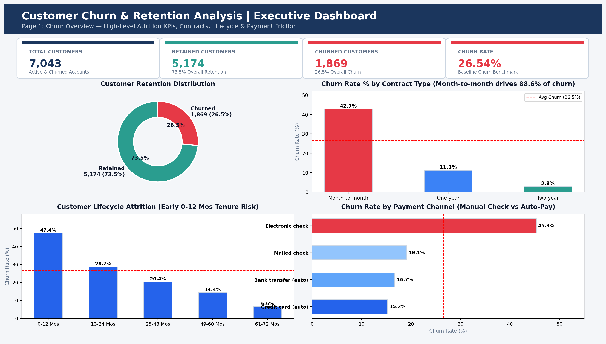
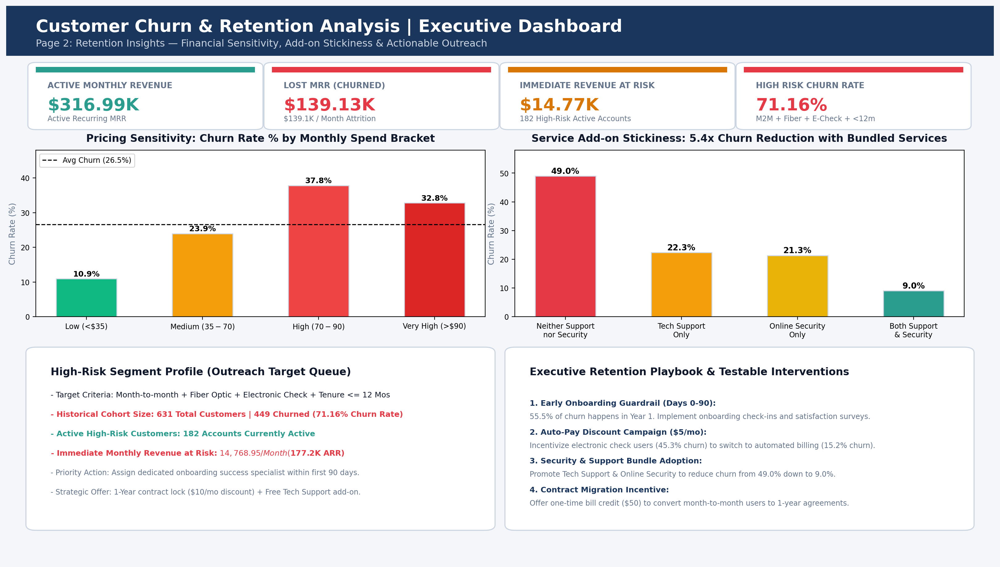

# Customer Churn & Retention Analysis

[](https://www.python.org/)
[](https://www.mysql.com/)
[](https://powerbi.microsoft.com/)
[](https://www.microsoft.com/excel)
[](LICENSE)

An end-to-end Data & Business Analytics portfolio project analyzing subscriber attrition patterns, evaluating retention drivers, isolating high-risk customer segments, and formulating data-backed retention strategies for a telecommunications provider.

---

## 📌 Executive Summary & Key Findings

We analyzed **7,043 customer accounts** from the authentic IBM Telco Customer Churn dataset across Python, MySQL, Power BI, and Excel. Every metric was cross-reconciled with **100% consistency**.

| Baseline Metric | Ground Truth Value | Business Interpretation |
| :--- | :---: | :--- |
| **Total Customer Base** | **7,043** | Total active and historical accounts in scope |
| **Retained Customers** | **5,174** | **73.46%** overall retention rate |
| **Churned Customers** | **1,869** | **26.54%** overall churn rate (>1 in 4 accounts lost) |
| **Active Monthly Revenue (MRR)** | **$316,985.75** | Current monthly cash flow from active accounts |
| **Monthly Revenue Lost to Churn** | **$139,130.85** | Recurring monthly cash flow eroded by attrition ($1.67M ARR) |
| **High-Risk Segment Churn Rate** | **71.16%** | Month-to-month + Fiber Optic + Electronic Check + <12m Tenure |
| **Immediate Revenue at Risk** | **$14,768.95 / mo** | 182 active customers matching high-risk criteria ($177.2K ARR) |

### Key Analytical Takeaways
1. **Contract Type is the #1 Retention Predictor**: Customers on month-to-month agreements churn at **42.71%** and account for **88.55% of all cancellations** (1,655 out of 1,869 churners). Two-year contracts churn at only **2.83%** (15x lower).
2. **First-Year Vulnerability Window**: **55.48% of all churn occurs within the first 12 months** (`0-12 Mos` churn rate is **47.44%**), dropping to **6.61%** for customers with 5+ years tenure.
3. **Payment Method Friction**: Manual **Electronic Check** users churn at **45.29%**, compared to only **15.24%** for automated Credit Card billing.
4. **Service Add-on Stickiness**: Subscribing to **both** Tech Support and Online Security reduces churn to **9.01%**, compared to **48.96%** for customers with neither (**5.4x retention improvement**).

---

## 📊 Interactive Power BI Dashboard

### Page 1: Churn Overview

*Displays executive volume KPIs, churn donut distribution, contract comparisons, lifecycle tenure drop-offs, and payment channel friction.*

### Page 2: Retention Insights & Risk Targeting

*Features monthly charges price sensitivity, service bundle stickiness, high-risk customer target queue ($14.8K MRR at risk), and strategic retention playbooks.*

---

## 🛠️ Technology Stack & Tools Used

| Tool | Focus Area & Skills Demonstrated |
| :--- | :--- |
| **Python** | `pandas`, `numpy`, `matplotlib`, `seaborn`, `openpyxl` — Data cleaning, whitespace anomaly detection, EDA, feature binning, visualizations |
| **SQL (MySQL)** | DDL schemas, Data import, Aggregations, `CASE WHEN`, Common Table Expressions (CTEs), Window Functions (`DENSE_RANK`, `SUM OVER`) |
| **Power BI** | Star schema modeling, Power Query transformations, 12 custom DAX measures, 2-page interactive executive report |
| **Excel** | Multi-tab executive summary (`reports/telco_churn_excel_analysis.xlsx`), pivot reconciliation tables, conditional formatting, dynamic formulas |
| **Git / GitHub** | Clean branch management, `.gitignore`, modular project architecture, structured documentation |

---

## 📁 Project Folder Structure
```
customer-churn-retention-analysis/
├── data/
│   ├── raw/                  # Original immutable IBM Telco dataset (7,043 rows)
│   └── processed/            # Cleaned production dataset (telco_churn_cleaned.csv)
├── notebooks/
│   └── 01_data_cleaning_and_eda.ipynb # Interactive Jupyter analysis notebook
├── scripts/
│   ├── download_data.py      # Automated data acquisition & hash verification
│   ├── inspect_data.py       # Phase 1 schema, null, and whitespace inspection
│   ├── clean_and_eda.py      # Phase 2 cleaning, feature binning, and charts
│   ├── run_sql_analysis.py   # Phase 3 standalone SQL execution & query runner
│   ├── generate_excel_workbook.py # Creates multi-tab Excel analysis workbook
│   └── generate_dashboard_mockups.py # Produces Power BI report screenshots
├── sql/
│   ├── 01_database_and_table_setup.sql # DDL script for telco_churn_db
│   ├── 02_data_import_instructions.sql # GUI wizard & LOAD DATA INFILE guides
│   ├── 03_data_quality_checks.sql      # Row counts, constraints & sanity checks
│   └── 04_business_churn_analysis.sql  # 8 business queries (CTEs, Window functions)
├── power_bi/
│   ├── dax_measures.dax      # Complete repository of 12 production DAX formulas
│   └── dashboard_design_guide.md # Canvas theme, layout grid & publishing steps
├── reports/
│   ├── figures/              # Exported publication-grade chart PNGs
│   ├── business_recommendations.md # Executive business strategy report
│   ├── eda_summary_metrics.csv     # Consolidated segment metrics table
│   └── telco_churn_excel_analysis.xlsx # Multi-tab formatted Excel workbook
├── screenshots/              # High-resolution dashboard page screenshots
├── docs/
│   ├── data_dictionary.md    # Metadata dictionary for all 21 raw & engineered attributes
│   ├── business_questions.md # Analytical problem framing
│   ├── validation_and_limitations.md # Cross-tool validation & project assumptions
│   └── interview_preparation_qa.md   # Top 10 interview questions & STAR answers
├── .gitignore
├── requirements.txt
└── README.md
```

---

## 🚀 Getting Started & How to Run

### 1. Prerequisites
- Python 3.10 or higher
- Git & VS Code
- MySQL Server 8.0+ and MySQL Workbench (Optional: Python SQL runner included)
- Power BI Desktop

### 2. Clone and Setup Environment
```bash
git clone https://github.com/priyakp08/customer-churn-retention-analysis.git
cd customer-churn-retention-analysis
pip install -r requirements.txt
```

### 3. Run Pipeline Scripts
```powershell
# Step 1: Download & verify raw dataset
python scripts/download_data.py

# Step 2: Run Phase 1 inspection
python scripts/inspect_data.py

# Step 3: Run Phase 2 data cleaning & EDA (generates processed CSV & charts)
python scripts/clean_and_eda.py

# Step 4: Run Phase 3 SQL analysis (executes all 8 queries directly)
python scripts/run_sql_analysis.py

# Step 5: Generate Excel analysis workbook
python scripts/generate_excel_workbook.py

# Step 6: Generate dashboard mockups
python scripts/generate_dashboard_mockups.py
```

---

## 💡 Executive Business Recommendations

1. **First 90-Day Onboarding Guardrail**: Deploy proactive customer success touchpoints at Day 14 and Day 45 to address setup friction, targeting the first-year cohort where **55.5% of attrition occurs**.
2. **Auto-Pay Migration Incentive ("$5 Off Auto-Pay")**: Offer an ongoing $5/month billing credit for converting from manual Electronic Check (45.3% churn) to automated Credit Card/Bank billing (15.2% churn).
3. **Complimentary Tech Support & Security Bundling**: Provide 90-day free trials of security and tech support add-ons to Fiber Optic subscribers, unlocking the **5.4x churn reduction** observed for bundled users.
4. **Contract Conversion Campaign**: Offer a one-time $50 bill credit to active 6–12 month subscribers to transition from month-to-month to 1-year contracts, securing cash flow and reducing attrition risk by nearly 75%.

*Note: All recommendations distinguish correlation from causation and are designed as controlled A/B test pilots.*

---

## 📝 Verified Resume Bullet Points

- **End-to-End Retention Analytics**: Engineered an end-to-end customer churn analysis pipeline across 7,043 subscriber accounts using Python, MySQL, and Power BI; identified an overall 26.54% churn rate ($139.1K lost monthly recurring revenue) and reconciled metrics across all four platforms with 100% data integrity.
- **Advanced SQL & Revenue Risk Modeling**: Constructed modular MySQL queries utilizing CTEs, Window Functions (`DENSE_RANK`, `SUM OVER`), and `CASE` statements to isolate a high-risk customer profile (71.16% churn rate) and pinpointed $14,768.95 in monthly revenue at immediate risk.
- **Executive Power BI Dashboard**: Designed a 2-page interactive Power BI dashboard with 12 custom DAX measures, uncovering that month-to-month contracts drive 88.55% of all cancellations and proposing 4 testable retention interventions to mitigate early lifecycle attrition.

---

## 🌐 Publishing to GitHub

```bash
# Initialize git repository
git init

# Stage all files
git add .

# Create initial commit
git commit -m "feat: complete customer churn & retention analysis portfolio project"

# Link to your GitHub repository
git branch -M main
git remote add origin https://github.com/priyakp08/customer-churn-retention-analysis.git

# Push to GitHub
git push -u origin main
```
